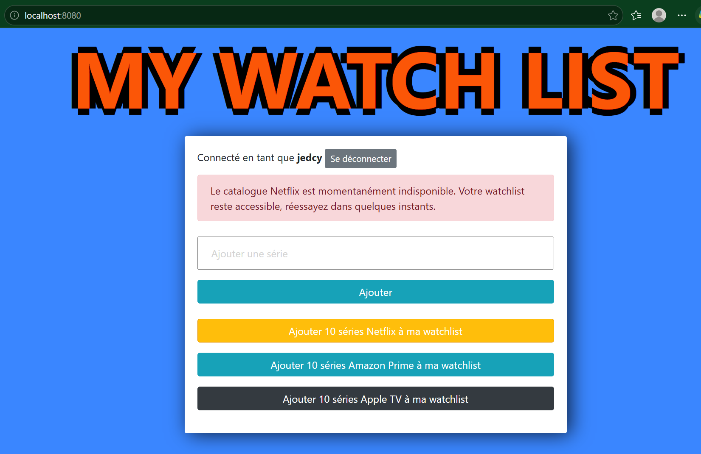

# My Watch List

Watchlist de séries (Django) alimentée par l'API TMDB.

## Lancer le projet avec Docker

1. Copier `.env.example` en `.env` et le remplir
2. `docker compose up -d --build`
3. `docker compose exec app python manage.py create_loadtest_users`
4. Ouvrir http://localhost:8080

Plusieurs instances : `docker compose up -d --scale app=3` puis `docker compose restart web`.

## Architecture

- `web` : nginx, reverse proxy et load balancer (round robin), sert les fichiers statiques
- `app` : Django + gunicorn (3 workers par instance)
- `db` : PostgreSQL
- `migrate` : tâche ponctuelle (migrations + collectstatic), exécutée une seule fois au démarrage

Tous les secrets (SECRET_KEY, token TMDB, identifiants Google, mot de passe PostgreSQL)
sont dans le fichier `.env`, jamais dans le code. DEBUG est désactivé dans Docker.

## Test de charge

Outil : Locust (`loadtest/locustfile.py`).
Scénario : connexion, consultation de la watchlist, ajout de séries, marquage « vue », navigation.
Pause de 1 à 3 s entre deux actions (comportement humain). Aucun appel à TMDB.

Commande : `python -m locust -f loadtest/locustfile.py --host <URL> -u <N> -r 10 -t 1m --headless --only-summary`

| Configuration | Utilisateurs | Débit (req/s) | Moyenne (ms) | p95 (ms) | Erreurs (%) |
|---|---|---|---|---|---|
| Baseline (runserver + SQLite + DEBUG) | 50 | 36,8 | 31 | 68 | 0 % |
| Baseline | 100 | 71,7 | 41 | 110 | 0 % |
| Baseline | 200 | 76,3 | 875 | 7 000 | 6,4 % |
| Multi-services (nginx + gunicorn + PostgreSQL) | 50 | 38,2 | 43 | 73 | 0 % |
| Multi-services | 100 | 72,4 | 52 | 100 | 0 % |
| Multi-services | 200 | 127,2 | 74 | 470 | 0 % |
| 3 instances app | 50 | 36,9 | 39 | 75 | 0 % |
| 3 instances app | 100 | 71,4 | 39 | 82 | 0 % |
| 3 instances app | 200 | 129,7 | 46 | 160 | 0 % |

## Observations

**Baseline :** l'application tient 100 utilisateurs sans erreur. À 200, elle sature : le débit
plafonne autour de 76 req/s, le p95 atteint 7 s et 6,4 % des requêtes échouent. Toutes les erreurs
(HTTP 500) concernent des écritures (ajout, marquage, connexion) : SQLite n'accepte qu'une écriture
à la fois et bloque sous la charge. La connexion est l'opération la plus lente, car le hachage du
mot de passe est volontairement coûteux.

**Multi-services :** à 200 utilisateurs, le débit passe de 76 à 127 req/s, le p95 tombe de 7 s à
470 ms et les erreurs disparaissent. PostgreSQL gère les écritures concurrentes et gunicorn traite
plusieurs requêtes en parallèle. À faible charge, les temps sont légèrement plus élevés (~10 ms) :
c'est le coût du passage par nginx et du réseau entre conteneurs.

**3 instances :** nginx répartit les requêtes en round robin (vérifié avec l'en-tête `X-Upstream`).
À 200 utilisateurs, le p95 passe de 470 à 160 ms et la connexion de ~740 à ~445 ms, car le calcul
du hachage est réparti sur 3 conteneurs. Le débit ne change presque plus (127 → 130 req/s) : il est
limité par le scénario lui-même (pauses de 1 à 3 s entre deux clics), l'application n'étant plus
saturée.

**Nouveau goulot d'étranglement :** la base PostgreSQL unique, partagée par toutes les instances,
et le processeur de la machine, que se partagent tous les conteneurs et le générateur de charge.
Ajouter des instances `app` ne fait pas monter ces deux limites.

## Sessions avec plusieurs instances

Les sessions Django sont stockées en base (table `django_session`, PostgreSQL) et toutes les
instances partagent la même SECRET_KEY. Un utilisateur reste donc connecté quelle que soit
l'instance qui répond. Avec des sessions en mémoire ou en fichier local, il serait déconnecté
dès qu'une requête tombe sur une autre instance.

Dans nginx, la directive `zone` dans le bloc `upstream` partage le compteur du round robin entre
les workers nginx. Sans elle, chaque worker garde son propre compteur et la répartition
n'est pas régulière.

## Checklist de déploiement

`python manage.py check --deploy` laisse 4 avertissements liés à HTTPS (HSTS, redirection SSL,
cookies sécurisés), désactivés volontairement car l'environnement local est en HTTP. Ils sont
activables par variables d'environnement (`DJANGO_SECURE_COOKIES`, `DJANGO_SSL_REDIRECT`,
`DJANGO_HSTS_SECONDS`).

## Comportement pendant une panne de TMDB

Panne simulée en arrêtant la passerelle (`docker compose stop tmdb-gateway`) :
la watchlist reste consultable et les boutons d'ajout affichent un message clair, immédiatement.

## Partie 2 : résister aux pannes externes

### Architecture complétée

- `redis` : cache des réponses TMDB, partagé par toutes les instances `app`
- `tmdb-gateway` : passerelle nginx vers l'API TMDB. L'URL de TMDB est configurable
  (`TMDB_BASE_URL`) ; arrêter ce conteneur simule une panne de TMDB.

### Exercice 4 : cache Redis pour TMDB

Scénario `loadtest/locustfile_tmdb.py` : même parcours qu'en partie 1, avec en plus des clics
massifs sur « Ajouter 10 séries » (Netflix, Prime, Apple TV). Charge volontairement modérée
(30 utilisateurs) pour ne pas saturer TMDB, dont l'adresse IP est partagée par toute la salle.

Commande : `python -m locust -f loadtest/locustfile_tmdb.py --host http://localhost:8080 -u 30 -r 5 -t 1m --headless --only-summary`

| Configuration (30 utilisateurs) | Débit (req/s) | Moyenne (ms) | p95 (ms) | Erreurs (%) | Bouton TMDB : moyenne / p95 / erreurs |
|---|---|---|---|---|---|
| Sans cache (`TMDB_CACHE_TTL=0`) | 17,4 | 380 | 2 700 | 9,1 % | 1 462 ms / 5 100 ms / 64,8 % |
| Avec cache Redis (5 min) | 20,5 | 51 | 110 | 0 % | 102 ms / 140 ms / 0 % |

Sans cache, 65 % des clics sur « Ajouter 10 séries » échouent et le p95 atteint 5 s : TMDB limite
le nombre de requêtes et répond lentement. L'effet se propage à toute l'application : les workers
gunicorn restent bloqués à attendre TMDB, et même la consultation de la watchlist monte à 1,3 s
au p95. Avec le cache (une clé par plateforme et par page, commune à tous les utilisateurs),
les erreurs disparaissent, le bouton répond en 100 ms et le p95 global passe de 2,7 s à 110 ms.

### Exercice 5 : résilience

- **Timeouts** sur chaque appel TMDB : 3 s pour la connexion, 5 s pour la réponse.
- **Gestion d'erreur** : toute erreur TMDB (panne, délai dépassé, limite de requêtes) affiche un
  message clair au lieu d'une erreur 500. La watchlist reste consultable.
- **Coupe-circuit** : après un échec, TMDB